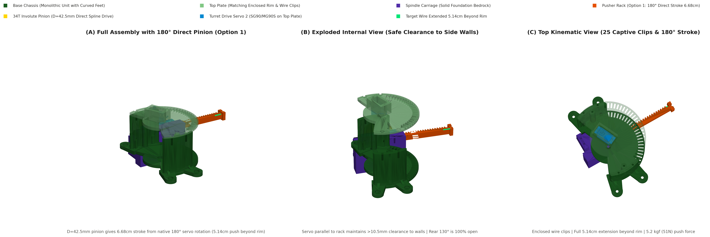

# DesignDIM

> **Unified Multi-Product Hardware Engineering & 3D Printable Mechanism Repository**

Welcome to **DesignDIM** — a centralized repository housing production-grade physical mechanism designs, parametric CAD scripts, additive manufacturing (3D printing) STLs, Bills of Materials (BOM), assembly guides, and servo kinematics specifications.

DesignDIM is engineered as a multi-product portfolio repository where each hardware design is completely self-contained with its own CAD generators, watertight STL models, documentation, renders, and assembly guides.

---

## Product Catalog

The following hardware products and mechanisms are maintained within the DesignDIM portfolio:

| ID | Product Name | Primary Mechanism / Actuation | Envelope / Key Spec | Status | Direct Links |
| :--- | :--- | :--- | :--- | :---: | :--- |
| **PRD-001** | **Wirex** | 25-Channel Wire Selector & Heavy-Duty Linear Pusher (MG996R 180° Involute Rack & Pinion + SG90 Turret) | $6.68\text{ cm}$ stroke ($51\text{ N}$ linear thrust), monolithic flush mounting base with 4x M4 counterbores | `Production Ready (v1.0)` | [Product README](products/Wirex/README.md) • [CAD Code](products/Wirex/cad/wire_selector.py) • [BOM](products/Wirex/docs/bom.md) • [Assembly Guide](products/Wirex/docs/assembly_guide.md) • [STLs](products/Wirex/stl/) |
| **PRD-002** | *Autonomous Feed Flow & Dispenser* | Rotary metering valve & linear chute feeder | Modular hopper & high-torque low-RPM feed mechanism | `In Planning` | [Design Spec Pipeline](products/Wirex/docs/) |
| **PRD-003** | *Multi-Axis Robotic Workcell* | Articulated compliant robotic manipulator | Multi-DoF precision servo linkages & end-effectors | `In Planning` | [Design Spec Pipeline](products/Wirex/docs/) |

---

## Featured Product: Wirex (PRD-001)

**Wirex** is a robust, 3D-printable 25-channel wire selector and heavy-duty linear pusher engineered for wire-harness routing, sorting, and selective automated feed applications.



### Core Highlights:
1. **Heavy-Duty Monolithic Base Chassis (`base_chassis.stl`)**:
   - $100\%$ flat bottom ($Z = 0$) for flush mounting to any wall, panel, or tabletop with zero underside protrusion.
   - 4 external counterbored mounting feet ($R = 74.0\text{ mm}$) for standard M4 socket head cap screws (DIN 912) sitting completely flush.
   - Continuous ski-jump gusset ribs ($24\text{ mm}$ tall) and tangent fillets eliminating stress concentrations.
   - 25 captive wire guide pockets with tangent circular bullet-nose pointers ($R = 0.8\text{ mm}$) and circular bullnose entry lips ($R = 1.4\text{ mm}$) for zero-snag operation.
   - $130^\circ$ wide-open rear swing sector ($180^\circ \to 310^\circ$) for unobstructed turret swing.
2. **Direct 180° Involute Pinion & Rack Actuator**:
   - High-torque MG996R servo driving a 34-tooth Module-1.25 involute pinion ($D = 42.5\text{ mm}$).
   - $125\text{ mm}$ conjugate trapezoidal rack delivering $66.76\text{ mm}$ stroke ($5.14\text{ cm}$ push beyond housing rim) and over $51\text{ N}$ ($5.2\text{ kgf}$) of linear thrust.
3. **Open-Cradle Spindle Carriage (`spindle_carriage.stl`)**:
   - Rapid drop-in servo bay with direct line-of-sight screwdriver access for all 4 fasteners.
   - Continuous rigid sliding track with $0.4\text{ mm}$ running clearance.
4. **Coaxial Top-Mounted Angular Turret Servo (SG90/MG90S)**:
   - Houses the turret rotation servo inverted on top of the screw-down top plate, engaging the spindle hub directly.

---

## Repository Structure & Multi-Product Layout

Each product in DesignDIM follows a strict self-contained layout under `products/<Product-Name>/` (also accessible via the `designs/` alias):

```
DesignDIM/
├── README.md                      # Master repository catalog & index (this file)
├── .gitignore                     # Build, cache, and system exclusions
├── designs/                       # Repository alias (symlink to products/)
└── products/                      # Directory holding all individual products
    └── Wirex/                     # Product PRD-001: 25-Channel Wire Selector
        ├── README.md              # Detailed product-level documentation
        ├── cad/                   # Parametric CAD models & code generators
        │   ├── build_two_support_assembly.py
        │   └── wire_selector.py   # Unified Manifold3D/Trimesh CAD generator
        ├── docs/                  # Engineering specifications & documentation
        │   ├── assembly_guide.md  # Step-by-step physical assembly guide
        │   ├── bom.md             # Complete Bill of Materials & hardware specs
        │   ├── calibration.md     # Servo calibration and PWM angle mapping
        │   └── design_spec.md     # Kinematic calculations & design specs
        ├── images/                # Visual inspection renders and diagrams
        │   ├── assembly_preview.png
        │   ├── mounting_and_screw_detail.png
        │   ├── spindle_mechanism_fit.png
        │   ├── spindle_pivot_detail.png
        │   ├── actuator_cover_and_support_detail.png
        │   └── groove_detail_closeup.png
        └── stl/                   # 100% Watertight 3D printable meshes
            ├── actuator_cover.stl
            ├── base_chassis.stl
            ├── pinion_gear.stl
            ├── pusher_rack.stl
            ├── spindle_bushing.stl
            ├── spindle_carriage.stl
            └── top_plate.stl
```

---

## Engineering Standards & Validation

All models in the DesignDIM repository adhere to strict mechanical and manufacturing quality standards:

- **Watertight Manifold Geometry**: $100\%$ single-body watertight meshes verified with zero non-manifold edges, zero self-intersections, and positive oriented volumes.
- **Parametric Scripting**: Deterministic generation using `manifold3d` Boolean CSG and `trimesh` verification pipelines.
- **Standardized Metric Fasteners**: Engineered around ISO metric standards (M3/M4 DIN 912 socket head screws, standard brass threaded heat-set inserts).
- **Additive Manufacturing Tolerances**: Standardized $0.4\text{ mm}$ running clearance for sliding fits and $0.2\text{ mm}$ press-fit allowances for direct 3D printing without post-machining.

---

## Quick Start: Regenerating CAD & Meshes

To regenerate all 3D STL models and assembly preview visualizers for a specific product (e.g. Wirex):

```bash
# Navigate to the product folder
cd products/Wirex

# Run the unified CAD generator
python3 cad/wire_selector.py
```

### STL Mesh Validation Matrix (Wirex)

| Part File | Status | Faces | Vertices | Connected Bodies |
| :--- | :---: | :---: | :---: | :---: |
| `actuator_cover.stl` | **100% Watertight Manifold** | 276 | 136 | 1 |
| `base_chassis.stl` | **100% Watertight Manifold** | 13,346 | 6,615 | 1 |
| `pinion_gear.stl` | **100% Watertight Manifold** | 3,856 | 1,928 | 1 |
| `pusher_rack.stl` | **100% Watertight Manifold** | 2,432 | 1,218 | 1 |
| `spindle_carriage.stl` | **100% Watertight Manifold** | 1,096 | 542 | 1 |
| `top_plate.stl` | **100% Watertight Manifold** | 10,356 | 5,116 | 1 |
| `spindle_bushing.stl` | **100% Watertight Manifold** | 288 | 144 | 1 |

---

## License & Attribution

Designed and maintained by **Nagakiran** (@Nagakiran1).
All rights reserved / Open for engineering collaboration under DesignDIM.

