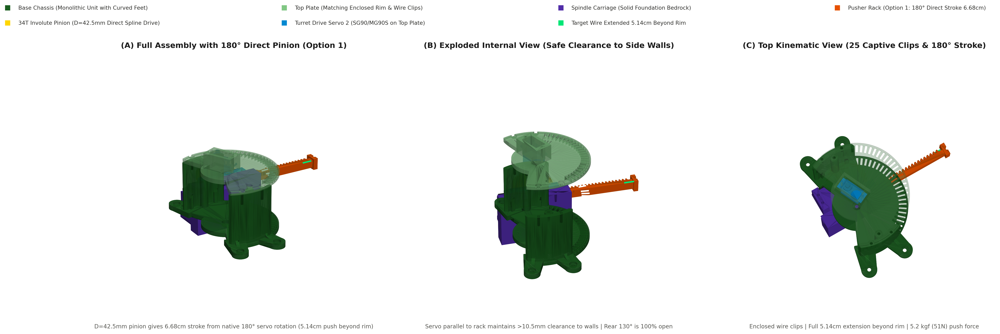
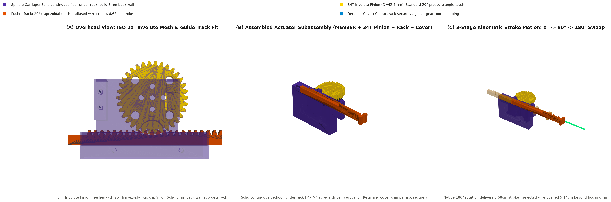

# Wirex: 25-Channel Wire Selector & Heavy-Duty Linear Pusher (with Heavy-Duty Mounting Base)

A robust, 3D-printable 25-channel wire selector and heavy-duty linear pusher powered by an **MG996R standard metal-gear servo** with a **direct 34-tooth module-1.25 pinion** ($D = 42.5\text{ mm}$, $R_p = 21.25\text{ mm}$) delivering a **$6.68\text{ cm}$ linear stroke ($5.14\text{ cm}$ push beyond the housing rim)** from a standard **$180^\circ$ servo rotation**, with **$5.2\text{ kgf} \approx 51\text{ N}$** of linear thrust.



## Architecture Overview

1. **Heavy-Duty Monolithic Base Mounting Feet (Outside Boundary)**:
   - 4 reinforced external mounting feet located at $R = 74.0\text{ mm}$ directly integrated into the rigid $50^\circ$ side walls:
     - Left Wall: $138.0^\circ$ and $174.0^\circ$.
     - Right Wall: $316.0^\circ$ and $352.0^\circ$.
   - **Screw Holes**: Each foot features a precision **$\mathbf{4.5\text{ mm}}$ through-hole** for M4 bolts or screws, with an **$\mathbf{8.5\text{ mm}}$ counterbore recess ($2.8\text{ mm}$ deep)** so M4 socket head cap screws (DIN 912) sit completely flush.
   - **Curved Fillets & Concave Ski-Jump Gussets**: Continuous tangential blend fillets and sweeping concave gusset ribs ($24\text{ mm}$ tall, $4\text{ mm}$ thick) seamlessly tie each foot directly into the $5.5\text{ mm}$ thick vertical walls with zero sharp rectangular corners.
   - **Zero Hanging/Disconnected Parts**: 100% single watertight manifold body (`base_chassis.stl` has exactly 1 connected body, 0 non-manifold edges).
   - **100% Open Rear Clearance**: Sits along the side walls, leaving the entire $130^\circ$ rear swing sector ($180^\circ \to 310^\circ$) completely unobstructed for the central turret and rack tail.

2. **Option 1 Direct 180° Involute Pinion Drive**:
   - **$42.5\text{ mm}$ Pitch Diameter Pinion ($R_p = 21.25\text{ mm}$, 34 teeth, Module 1.25)** mounted directly to the MG996R output spline. Features true standard ISO 20° pressure-angle involute teeth with tapered flanks and dedendum root fillets.
   - Converts standard $180^\circ$ ($\pi\text{ rad}$) rotation into **$66.76\text{ mm}$ ($\approx 6.68\text{ cm}$)** of linear travel.
   - Pushes the selected wire **$5.14\text{ cm}$ beyond the outer rim** ($R = 109.8\text{ mm}$ extended tip).
   - Delivers over **$5.2\text{ kgf}$ ($51\text{ N}$)** of linear thrust with conjugate rolling meshing.
   - The MG996R is nested lengthwise parallel to the rack, keeping the maximum rotating radius of the servo under $37.3\text{ mm}$ and the pinion under $42.5\text{ mm}$—maintaining over **$10.4\text{ mm}$ of safety clearance** to the housing side walls at all times.

3. **Monolithic Flush Base Chassis (`base_chassis.stl`)**:
   - Integrates the bottom plate, two $50^\circ$ curved upright side walls ($130^\circ \to 180^\circ$ and $310^\circ \to 360^\circ$) with bullnose rounded termination ends, two structural support link pillars ($155^\circ$ and $335^\circ$), and the 4 external counterbored mounting feet into **one single solid printed part**.
   - **100% Flat Bottom ($Z = 0$)**: No under-mount servo protrusion; bolts directly flush to any wall, board, or tabletop with zero gap!
   - **Curved Wire Grooves & Bullet-Nose Pointers**: 25 captive guide pockets feature tangent circular bullet-nose pointers ($R = 0.8\text{ mm}$) and revolved circular bullnose entry lips ($R = 1.4\text{ mm}$) to minimize wire friction and eliminate snagging during pull/push operations.
   - Rear $130^\circ$ sector ($180^\circ \to 310^\circ$) has smooth tangent S-curve transitions and is **100% open**, providing completely unobstructed clearance for the central turret and rack tail swing.

4. **Screw-Down Top Plate with Top-Mounted Servo 2 (`top_plate.stl`)**:
   - Features matching curved wire clips with circular entry lips and fastens down rigidly with 6x M3 screws into the base uprights and pillars.
   - **Integrated Top-Mount Bracket for Servo 2 (SG90/MG90S)**: Houses the turret rotation servo inverted on top, coaxial with the central pivot, engaging the top hub of the spindle carriage directly. Readily accessible from above for maintenance and calibration.

5. **Open-Cradle Spindle Carriage (`spindle_carriage.stl`)**:
   - Eliminates enclosed box design: features an open bay where the MG996R servo drops in freely.
   - Features 4x M3/M4 pilot tap holes on front and rear stanchions with **100% direct line-of-sight screwdriver access**.
   - **Through-Guide Channel with 0.4mm Running Clearance**: Full linear slide track with zero interference collision across the entire stroke range.
   - Built-in bottom shelf, cable routing notch, radial rack guide channel, and top horn coupling socket.



---

## Directory Structure

```
Wirex/
├── cad/
│   └── wire_selector.py          # Unified CAD generator (manifold3d/trimesh) & multi-view visualizer
├── stl/
│   ├── base_chassis.stl          # Monolithic bottom plate with integrated walls, links & 4 mounting feet
│   ├── top_plate.stl             # Screw-down top cover plate with enclosed wire clips
│   ├── spindle_carriage.stl      # Heavy-duty central rotating turret housing the MG996R
│   ├── pusher_rack.stl           # 125mm module-1.25 toothed rack (6.68cm stroke)
│   ├── pinion_gear.stl           # 34-tooth module-1.25 pinion (D=42.5mm for 180° drive)
│   └── actuator_cover.stl        # Guide retainer clip for rack
├── docs/
│   ├── design_spec.md            # Detailed engineering kinematics & specifications
│   ├── assembly_guide.md         # Step-by-step assembly guide
│   ├── bom.md                    # Bill of materials
│   └── calibration.md            # Servo calibration & angle mapping
├── images/
│   ├── assembly_preview.png      # Authoritative 3-panel assembly preview render
│   ├── mounting_and_screw_detail.png # Detailed inspection render of base mount & screw holes
│   └── spindle_mechanism_fit.png # Dedicated 3-panel rack, pinion, and carriage fit visualizer
└── README.md                     # Clean project overview and quick start guide
```

---

## Quick Start: Regenerating CAD & STLs

To regenerate all STL models and the 3D assembly preview images:

```bash
python3 cad/wire_selector.py
```

### STL Mesh Validation Status

| Part File | Status | Faces | Vertices | Connected Bodies |
| :--- | :--- | :---: | :---: | :---: |
| `actuator_cover.stl` | **100% Watertight Manifold** | 276 | 136 | 1 |
| `base_chassis.stl` | **100% Watertight Manifold** | 13,346 | 6,615 | 1 |
| `pinion_gear.stl` | **100% Watertight Manifold** | 3,856 | 1,928 | 1 |
| `pusher_rack.stl` | **100% Watertight Manifold** | 2,432 | 1,218 | 1 |
| `spindle_carriage.stl` | **100% Watertight Manifold** | 1,096 | 542 | 1 |
| `top_plate.stl` | **100% Watertight Manifold** | 10,356 | 5,116 | 1 |
